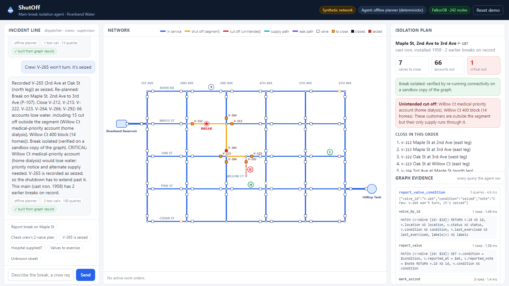
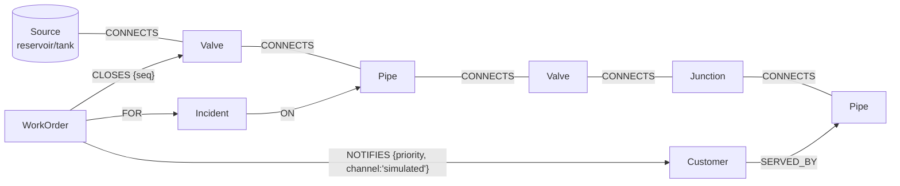

# ShutOff — a water-main-break isolation agent on FalkorDB

> **Track:** Agents That Act on Connected Data (Graph Hacks, WeMakeDevs × FalkorDB, Oct 2026)
> **Data:** 100% synthetic. "Riverbend" and every pipe, valve, customer and incident in it are invented.

When a water main breaks, a utility has to decide fast **which valves to shut**. The answer is a
graph problem. The area you can isolate (a *segment*) is bounded by valves. One **seized valve**
silently enlarges the shutdown. Closing valves can also **cut off homes outside the segment**
whose only supply ran through it, such as a home-dialysis patient at the end of a cul-de-sac.

ShutOff turns a dispatcher's message ("water gushing on Maple St between 2nd and 3rd") into a
**verified isolation plan**, then acts on it once a supervisor approves:

1. **Locate** the broken main in the network graph. Unknown or ambiguous places are reported, never guessed.
2. **Plan**: find the isolation segment with `algo.WCC`, and list its boundary valves.
3. **Simulate** the closures on a **sandbox copy of the graph** (`GRAPH.COPY`). This answers three questions:
   is the break really cut off from every source, who loses water, and are the hospital and other
   critical customers still supplied (with the `algo.SPpaths` path as proof)?
4. **Pre-compute contingencies**: "if V-265 won't turn, you need these 7 valves instead, and the dialysis account loses water".
5. **Check human plans**: "can we just close the two nearest valves?" gets the answer *No*, plus the exact path water still takes to the break.
6. **Record field reports**: "V-265 is seized" becomes a `:Seized` label in the graph, and every later plan routes around it.
7. **Act** (human-approved): close the valves in the graph, open an `Incident` and a `WorkOrder`,
   and record priority and standard notices. The server **re-simulates before committing** and refuses
   a plan that leaks, depends on a seized valve, or **has a different impact from the one the approver was shown**.
   If a critical customer (e.g. the home-dialysis account) would lose water, approval requires an
   **explicit acknowledgement** of that customer, enforced server-side. *Crew dispatch and customer
   notices are simulated; nothing is sent.*
8. **Restore safely**: re-opening valves is checked on a sandbox first. A valve that another active
   work order relies on stays closed and is handed over to that work order, so restoring one break
   never re-feeds another.
9. **Prevent**: rank valves for exercising by simulating each one being seized ("which valve failure would hurt most?").



## Why the graph is essential

Every decision is a connectivity question on a looped network:

| Question | Graph operation |
|---|---|
| What is the smallest area I can shut off around this break? | Connected component (`algo.WCC`) of pipes/junctions with operable valves removed |
| Which valves do I close? | Valves adjacent to that component |
| A valve is seized: what now? | Same WCC, but `:Seized` valves are pass-through, so segments merge |
| Is the break still fed? Who loses water? | WCC on the sandbox after closures; components with no `Source` are dry |
| Prove the hospital is still supplied | `algo.SPpaths` from a `Source` to the hospital's main on the sandbox |
| Is it safe to re-open this work order's valves? | Sandbox: set each valve `:Open`, re-run WCC; keep it closed if another active break is no longer dry |
| Which valve should we exercise first? | One sandbox, toggle labels per valve, re-run WCC (96 scenarios on the fresh network, ~0.4 s) |

Take FalkorDB out and ShutOff cannot produce a plan, a leak path, a contingency or a ranking.
The language model never decides connectivity. The graph does.

### Algorithm correctness

The WCC result is cross-checked against an independent pure-Python union-find for every pipe in the
network (`tests/test_graph.py::test_falkordb_wcc_segments_match_independent_union_find`). The
"isolation segment" and "unintended isolation" concepts follow the water-distribution engineering
literature, for example Jun, Loganathan et al., *Water Resources Management* 22(6), 2008.

## Graph model



| Label | Key properties | Notes |
|---|---|---|
| `Source` | `id`, `name`, `kind` (reservoir/tank) | 2 |
| `Junction` | `id`, `name` ("Maple St & 3rd Ave") | 32 |
| `Pipe` | `id`, `street`, `crosses`, `label`, `material`, `installed`, `diameter_mm` | 53. A pipe is a **node** so breaks, customers and incidents can attach to it, and WCC can include or exclude it by label |
| `Valve` | `id`, `location`, `status` (open/closed), `condition` (ok/unknown/seized), `last_exercised` | 96. Sits between a junction/source and a pipe |
| `Customer` | `id`, `name`, `kind`, `accounts`, `critical` | 56. Hospital, care home and a medical-priority account are `critical` |
| `Incident`, `WorkOrder` | `id`, `at`, `status`, ... | Memory: past breaks (synthetic) and every work order ShutOff issues |

**State labels drive the algorithms.** `:Open` marks valves water can pass (supply analysis).
`:Seized` marks valves that can't be closed (isolation analysis). A crew report or a work order
changes these labels, and every later query sees the change.

## Cypher and algorithms the product depends on

All queries live in [`shutoff/queries.py`](shutoff/queries.py). The agent never writes Cypher.

**Isolation segment** (live graph, read-only):
```cypher
CALL algo.WCC({nodeLabels: ['Junction', 'Pipe', 'Seized'], relationshipTypes: ['CONNECTS']})
YIELD node, componentId
WITH componentId, collect(node) AS members
WHERE any(m IN members WHERE m:Pipe AND m.id = $pipe)
UNWIND members AS m
RETURN m.id AS id, labels(m)[0] AS kind
```
**Valves to close:**
```cypher
MATCH (m)-[:CONNECTS]-(v:Valve)
WHERE m.id IN $members AND NOT v:Seized AND NOT v.id IN $members
RETURN DISTINCT v.id AS id, v.location AS location, v.status AS status, v.condition AS condition
```
**Simulation** on a sandbox made with `GRAPH.COPY riverbend riverbend__sim_<id>`. Closing a valve there means deleting it, so later traversals respect the closure:
```cypher
MATCH (v:Valve) WHERE v.id IN $close OR v.status = 'closed' DETACH DELETE v
```
```cypher
CALL algo.WCC({nodeLabels: ['Source', 'Junction', 'Pipe', 'Valve'], relationshipTypes: ['CONNECTS']})
YIELD node, componentId
WITH componentId, collect(node) AS members
WHERE none(m IN members WHERE m:Source)          // components with no source are dry
UNWIND members AS m WITH m WHERE m:Pipe
RETURN m.id AS pipe
```
**Proof of supply / leak path:**
```cypher
MATCH (s:Source), (t {id: $target})
CALL algo.SPpaths({sourceNode: s, targetNode: t, relTypes: ['CONNECTS'], relDirection: 'both', pathCount: 1})
YIELD path, pathWeight
RETURN s.name AS source, [n IN nodes(path) | n.id] AS path, pathWeight AS hops
ORDER BY hops LIMIT 1
```
**Valve-exercise ranking**: one sandbox; for each valve, `REMOVE v:Open` on the merged boundary, then
WCC over `['Source','Junction','Pipe','Open']`, then `SET v:Open` back.

**Actions** (live graph, writes): `MARK_SEIZED` (`SET v:Seized`), `CREATE_WORK_ORDER`,
`WORK_ORDER_CLOSE_VALVES` (`CREATE (w)-[:CLOSES {seq}]->(v) SET v.status='closed' REMOVE v:Open`),
`WORK_ORDER_NOTIFY`, `RESTORE_WORK_ORDER`.

## Architecture

```
 Browser UI (web/)  ──HTTP──►  FastAPI (shutoff/api.py)
                                    │
                         agent.py ──┤  offline intent parser  (default, deterministic)
                                    │  or Claude tool loop    (if ANTHROPIC_API_KEY is set)
 MCP clients ──stdio/HTTP──► mcp_server.py
                                    │
                              tools.py   fixed catalogue, argument validation, human-gated actions
                                    │
                             network.py  plan / simulate / contingencies / actions
                                    │
                             queries.py  every Cypher query  ──►  FalkorDB (Docker)
                                                                   live graph + sandbox copies
```

**Agent design choices** (following the official guide's fixed-tool approach):
- **Fixed tool catalogue.** The model picks tools and fills typed arguments. IDs are format-validated and resolved against the graph before any query runs. Nothing the model writes is concatenated into Cypher.
- **Read tools use `ro_query`**. A test proves a write through the read path fails.
- **The model can't close valves.** `issue_work_order` and `restore_service` are not offered to the chat model. They run only on a human action (the Approve button or a typed "approve"). MCP marks them `destructiveHint` and requires `confirmed_by_human=true`.
- **Re-verification on commit.** `issue_work_order` re-runs the simulation server-side and refuses a plan that leaks, uses a seized valve, or whose impact (accounts out, critical customers) differs from what the approver saw. Critical cut-offs must be acknowledged customer by customer.
- **Impact is attributed correctly.** Outages already caused by other active work orders are measured as a baseline on the sandbox and reported separately, not counted against a new plan.
- **Safe restore.** Restoring a work order re-opens only valves no other active work order needs, checked on a sandbox.
- **Field reports must be explicit.** The offline parser records a valve as seized only when the sentence says so about that valve ("V-265 won't turn"), not when an ID is merely mentioned near a keyword.
- **Grounded replies.** In LLM mode, a reply naming a valve or pipe ID or an account count the graph didn't return is rejected and replaced with a summary built from tool results. The UI shows which happened.
- **Evidence panel.** Every tool call lists its Cypher, parameters, row counts, latency, and whether it ran on the sandbox.

## Run it locally

Requires Docker and Python 3.12.

```bash
docker compose up -d                      # FalkorDB on :6379, FalkorDB Browser on :3000
python -m venv .venv
.venv/Scripts/activate                    # Windows; on macOS/Linux: source .venv/bin/activate
pip install -r requirements.txt
python -m shutoff.seed                    # load the synthetic Riverbend network
uvicorn shutoff.api:app --port 8000       # open http://localhost:8000
```

- **Agent mode:** without `ANTHROPIC_API_KEY` the app uses the deterministic offline planner. That mode is labelled in the header and needs no network. With a key set, Claude (`claude-opus-5-5`, override with `SHUTOFF_MODEL`) chooses the tools.
- **Explore the graph:** open FalkorDB Browser at http://localhost:3000 and run the queries above against the `riverbend` graph.
- **MCP:** `python -m shutoff.mcp_server` (stdio) or `python -m shutoff.mcp_server --http 8765`.
  Example Claude Desktop config: `{"mcpServers": {"shutoff": {"command": "<path>/.venv/Scripts/python", "args": ["-m", "shutoff.mcp_server"], "cwd": "<path to repo>"}}}`.

### Tests

```bash
python -m pytest -q        # 40 tests, needs the FalkorDB container; uses a separate 'riverbend_test' graph
```
The tests cover:
- WCC versus an independent union-find.
- The Plan A, Plan B and naive-plan numbers.
- Leak paths made of real pipe connections.
- Refusals: seized valve, leaking plan, missing human confirmation, invalid or injected IDs.
- The sandbox never changing the live graph.
- Work order write and restore, including restore never re-feeding another active break.
- Critical-customer acknowledgement, approval bound to the shown impact, and impact attribution with other work orders active.
- `GRAPH.COPY` surviving a concurrent Redis background save (fork contention, retried).
- The HTTP API end to end.
- Priority notices.
- Unknown and ambiguous locations.
- The MCP tool gating.
- The LLM loop with a **mocked** client, including rejection of an invented valve ID.

## Demo video

`demo/shutoff-demo.webm` (about 1:45) is recorded by [`demo/record_demo.py`](demo/record_demo.py) with Playwright
against the running app and FalkorDB. Everything on screen is real app output. The script only types
the messages and overlays caption text.

## Demo script (≈3 min)

1. "Caller reports water gushing on Maple St between 2nd and 3rd Ave". Plan A: close 4 valves, 34 accounts out, no critical customers. It warns that V-265 hasn't been exercised since 2011, and that if V-265 fails the dialysis account is cut off.
2. "Crew wants to just close V-212 and V-213". Rejected, with the purple leak path drawn from the reservoir to the break.
3. "Is the hospital still supplied?". Yes, with a 14-hop path from Hilltop Tank.
4. "Crew: V-265 won't turn". The valve is recorded as seized and the plan is redone: 7 valves, 66 accounts, and an unintended cut-off of Willow Ct, including the medical-priority account.
5. Tick the acknowledgement (the dialysis account loses water), then **Approve** creates WO-1001. Valves turn black in the graph, a priority notice is recorded (simulated), and the outage shows on the map.
6. "Burst main on Elm St at 5th" returns *Not in the graph*. "Leak at Oak & 3rd" returns *ambiguous*, with the candidate mains listed.
7. "Which valves should we exercise first?" returns valves ranked by simulated impact.

## Measured performance (local Docker, this laptop)

| Operation | Median |
|---|---|
| Segment WCC query | ~2 ms |
| One closure simulation (copy, close, WCC, paths, cleanup) | ~115 ms |
| Full plan with 4 contingency simulations | ~0.5 s |
| Valve-exercise ranking (96 scenarios, fresh network) | ~0.4 s |

## Limitations (honest list)

- **Connectivity, not hydraulics.** ShutOff knows whether a path to a source exists, not whether pressure or flow would be adequate. A real deployment would pair it with a hydraulic model (e.g. EPANET).
- **Synthetic network.** The network is a 53-pipe grid built to show realistic situations: missing valves, a dead-end, unknown-condition valves. Results on real networks are untested.
- **Simulated outside world.** Crew dispatch and customer notifications are recorded as graph edges only. Nothing is sent.
- **LLM mode** is covered by mocked-client tests. It hasn't been run against the live API in this repo unless a key was configured; the offline planner covers the demo. The offline parser understands a limited set of phrasings.
- The valve-exercise score is a transparent heuristic (accounts out + 60 per critical customer, weighted by condition and years since exercised), not a calibrated risk model.
- Sessions are in memory; one demo user at a time.
- A valve recorded as seized is treated as impassable-to-close even if it is currently closed (conservative: segments may come out larger than necessary).
- Valves are modelled as two-way isolation points; check valves, pressure zones and PRVs are not modelled.
- `GRAPH.COPY` forks the database process. When Redis's own background save is forking at the same moment the copy is retried (up to 3 s); this is covered by a stress test.

## Originality, data and AI disclosure

- All code and the FalkorDB implementation were written during the hackathon (from 17 Oct 2026). Only general libraries are used (see `requirements.txt`).
- Inspired by, but distinct from, the official "Blast Radius" example. That example traverses an existing dependency graph read-only. ShutOff decides an intervention, simulates it on a graph copy, verifies post-conditions, changes the live graph after approval, and re-plans when the field contradicts it.
- Data is fully synthetic (`shutoff/town.py`). No personal, private or login-protected data is used.
- **AI assistance:** this project was built with an AI coding assistant (Claude Code, model Claude Opus 5.5). It did research, implementation, tests and documentation drafts under the participant's direction. See [docs/AI_DISCLOSURE.md](docs/AI_DISCLOSURE.md).
