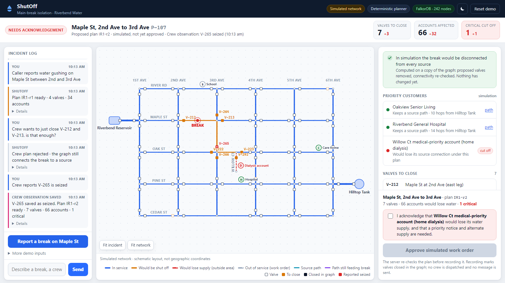
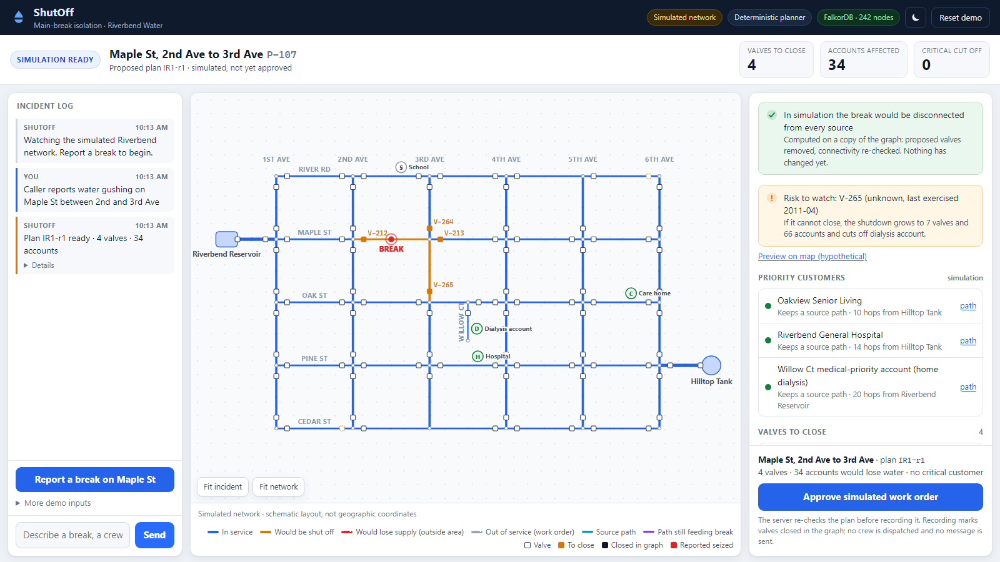
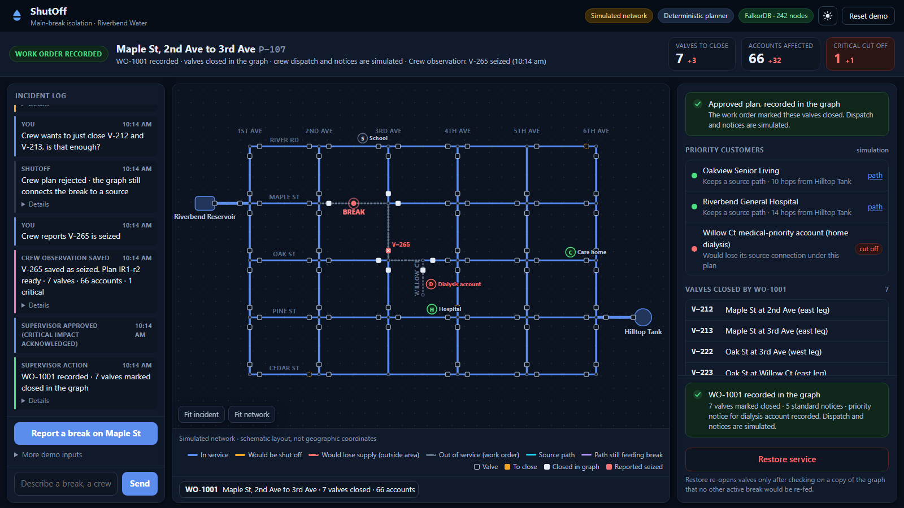
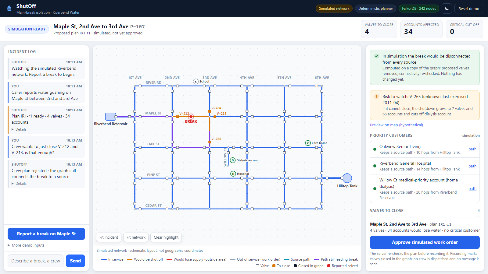
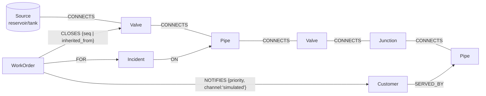

# ShutOff — water-main-break isolation on FalkorDB

> **Track:** Agents That Act on Connected Data (Graph Hacks, WeMakeDevs × FalkorDB, Oct 2026)
> **Data:** 100% synthetic. "Riverbend" and every pipe, valve, customer and incident in it are invented.

**ShutOff is a synthetic water-network isolation assistant.** FalkorDB derives and tests intervention
plans, exposes the connectivity evidence behind them, and updates the graph state only after explicit
human actions. ShutOff predicts critical-customer outages. Physical valve operation, hydraulic adequacy
(pressure and flow) and external dispatch are outside this prototype.



## The problem

When a water main breaks, the supervisor must decide quickly **which valves to close**.

- **Segments.** The area valves can wall off (a *segment*) depends on where valves are, and on which legs have none.
- **Seized valves.** A valve that will not turn silently enlarges the shutdown.
- **Unintended isolation.** Closing a segment can cut off customers *outside* it whose only supply ran through it, such as a home-dialysis account at the end of a cul-de-sac.

These are connectivity questions on a looped network, and they are established in the
water-distribution literature (e.g. [Jun et al. 2008](https://link.springer.com/article/10.1007/s11269-007-9188-6)).

## What ShutOff does

1. **Locates** the broken main from a report ("water gushing on Maple St between 2nd and 3rd"). Unknown or ambiguous places stop the workflow; nothing is guessed.
2. **Derives the isolation area** with `algo.WCC` (operable valves act as walls) and **the valves to close** (the valves bounding that area).
3. **Simulates** the closures on a **copy of the graph** (`GRAPH.COPY`):
   - Is the break disconnected from every source?
   - Who loses water, inside versus outside the area?
   - Which priority customers keep a source path (`algo.SPpaths` gives the path as evidence)?
4. **Predicts what happens if each valve cannot close.** These contingencies are hypothetical; previewing one records nothing.
5. **Checks a crew's alternative** ("just close V-212 and V-213?") and draws the route by which water would still reach the break.
6. **Records crew observations** ("Crew reports V-265 is seized") as graph state (`:Seized`) and re-plans. Questions and what-ifs never change the graph.
7. **Records a simulated work order after human approval.** The server re-simulates first and refuses if:
   - the break would still be connected,
   - a valve in the plan is seized,
   - the plan revision or the affected customers differ from what was shown,
   - a critical customer's cut-off was not explicitly acknowledged.

   Recording marks valves closed in the graph. **No crew is dispatched and no message is sent.**
8. **Restores safely.** Each valve is re-opened on a copy first. A valve that another active break still needs stays closed.

## Why FalkorDB is indispensable here

| Decision | Graph operation (in FalkorDB) |
|---|---|
| Smallest area valves can shut off | `algo.WCC` over `Junction`/`Pipe`/`Seized` nodes; operable valves are left out, so they act as walls |
| Valves to close | `CONNECTS` neighbours of that component |
| Seized valve | `SET v:Seized`, so the same WCC treats it as pass-through and segments merge |
| Is the break still connected? Who loses water? | `GRAPH.COPY` → delete the closed valves → WCC; components without a `Source` are dry |
| Evidence that the hospital keeps a source | `algo.SPpaths` from each `Source` on the copy |
| What if a valve cannot close? | Merge the neighbouring segment (WCC) → new boundary → simulate again |
| Is restoring safe? | On a copy: set the valve `:Open`, re-run WCC, check other active breaks stay dry |
| Which valves to exercise first | One copy; toggle `:Open` per valve; WCC (96 scenarios in ~0.4 s) |

Without FalkorDB there is no plan, no impact, no evidence path, no contingency and no restore check.
The language model (when enabled) only chooses among fixed tools. Connectivity always comes from graph queries.

### Correctness evidence

- **Riverbend:** FalkorDB's segments match an independent pure-Python union-find for all 53 pipes (`tests/test_graph.py`).
- **Public EPANET networks:** ShutOff's segment query matches the US EPA WNTR toolkit's `valve_segments` on Net1, Net3 and ky4 (964 nodes, 1,158 links). It matched in all 12 valve-layer configurations and all 60 seized-valve trials. See [docs/BENCHMARK_WNTR.md](docs/BENCHMARK_WNTR.md); run it with `python -m benchmarks.wntr_crosscheck`.

## The operator screen



- **Incident strip:** what happened, where, the plan revision, and valves / accounts / critical cut-offs, with deltas after a re-plan.
- **Map** (schematic, not geographic):
  - amber = would be shut off (simulation);
  - red dashed = would lose supply outside the area;
  - grey dashed = out of service under a recorded work order;
  - cyan = a source path; purple = the path still feeding the break.
- **Decision rail:**
  - the simulation verdict;
  - a **risk to watch** (the valve whose failure hurts most);
  - priority customers, each row drawing its path on the map;
  - valves to close, each row highlighting its valve on the map;
  - who loses water;
  - hypothetical contingencies that preview on the map;
  - graph evidence, collapsed, with every query one click deeper.
- **Approval dock:** always shows the plan it approves, the named critical customers and the acknowledgement.
- **Light and dark themes**, reduced-motion support, keyboard access, and tablet and phone layouts.

| Dark theme | Crew plan rejected (path still feeding the break) |
|---|---|
|  |  |

## Graph model



| Label | Key properties | Count |
|---|---|---|
| `Source` | `id`, `name`, `kind` (reservoir/tank) | 2 |
| `Junction` | `id`, `name` ("Maple St & 3rd Ave") | 32 |
| `Pipe` | `id`, `street`, `crosses`, `label`, `material`, `installed`, `diameter_mm` | 53. A node, so breaks, customers and incidents attach to it and WCC can filter by label |
| `Valve` | `id`, `location`, `status` (open/closed), `condition` (ok/unknown/seized), `last_exercised` | 96. Sits between a junction/source and a pipe |
| `Customer` | `id`, `name`, `kind`, `accounts`, `critical` | 56. Hospital, care home and a medical-priority account are `critical` |
| `Incident`, `WorkOrder` | `id`, `at`, `status`, … | Synthetic history plus every work order ShutOff records |

**State labels drive the algorithms.**
- `:Open` = water passes (supply analysis).
- `:Seized` = cannot be closed (isolation analysis).

Crew observations and work orders change these labels, and every later query sees the change.
`CONNECTS` direction is arbitrary; every query treats it as undirected (two-way isolation valves).

## Cypher and algorithms the product depends on

All 39 product queries are named constants in [`shutoff/queries.py`](shutoff/queries.py). The model never writes Cypher.

**Isolation area** (live graph, read-only):
```cypher
CALL algo.WCC({nodeLabels: ['Junction', 'Pipe', 'Seized'], relationshipTypes: ['CONNECTS']})
YIELD node, componentId
WITH componentId, collect(node) AS members
WHERE any(m IN members WHERE m:Pipe AND m.id = $pipe)
UNWIND members AS m
RETURN m.id AS id, labels(m)[0] AS kind
```
**Valves to close:**
```cypher
MATCH (m)-[:CONNECTS]-(v:Valve)
WHERE m.id IN $members AND NOT v:Seized AND NOT v.id IN $members
RETURN DISTINCT v.id AS id, v.location AS location, v.status AS status, v.condition AS condition
```
**Simulation** on a copy (`GRAPH.COPY riverbend riverbend__sim_<id>`). Existing closures are applied first and measured as a baseline, then the plan's closures; the plan's impact is the difference:
```cypher
MATCH (v:Valve) WHERE v.status = 'closed' DETACH DELETE v     // SIM_DELETE_CLOSED
MATCH (v:Valve) WHERE v.id IN $close DETACH DELETE v          // SIM_DELETE_VALVES
```
```cypher
CALL algo.WCC({nodeLabels: ['Source', 'Junction', 'Pipe', 'Valve'], relationshipTypes: ['CONNECTS']})
YIELD node, componentId
WITH componentId, collect(node) AS members
WHERE none(m IN members WHERE m:Source)          // components with no source are dry
UNWIND members AS m WITH m WHERE m:Pipe
RETURN m.id AS pipe
```
**Source path / path still feeding the break:**
```cypher
MATCH (s:Source), (t {id: $target})
CALL algo.SPpaths({sourceNode: s, targetNode: t, relTypes: ['CONNECTS'], relDirection: 'both', pathCount: 1})
YIELD path, pathWeight
RETURN s.name AS source, [n IN nodes(path) | n.id] AS path, pathWeight AS hops
ORDER BY hops LIMIT 1
```
**Writes:**
- `MARK_SEIZED` (`SET v:Seized`)
- `CREATE_WORK_ORDER`
- `WORK_ORDER_CLOSE_VALVES` (`CREATE (w)-[:CLOSES {seq}]->(v) SET v.status='closed' REMOVE v:Open`)
- `WORK_ORDER_NOTIFY`
- `REOPEN_VALVES`, `TRANSFER_HOLD`, `CLOSE_OUT_WORK_ORDER`

## Architecture and safeguards

```
 Browser UI (web/)  ──HTTP──►  FastAPI (shutoff/api.py)
                                    │
                         agent.py ──┤  deterministic planner (default; the verified mode)
                                    │  or Claude tool loop (only with ANTHROPIC_API_KEY; not live-tested)
 MCP clients ──stdio/HTTP──► mcp_server.py
                                    │
                              tools.py   fixed catalogue, argument validation, human-gated actions
                                    │
                             network.py  plan / simulate / contingencies / actions
                                    │
                             queries.py  every Cypher query  ──►  FalkorDB (Docker)
                                                                   live graph + throwaway copies
```

**Agent and tools**
- **Fixed tools, validated arguments.** IDs are format-checked and resolved against the graph before use. Read tools use `ro_query`, and a test proves they cannot write.
- **Observations versus questions.** A valve condition is recorded only from a statement ("Crew reports V-265 is seized"):
  - "Is V-265 seized?" uses the read-only `valve_status` tool;
  - "What if V-265 won't turn?" is answered from the plan's contingency simulation.
  - This is enforced for the deterministic parser and, server-side, for the model.

**Approving and restoring**
- **Human-only actions.** `issue_work_order` and `restore_service` are never offered to the model.
  - In the UI: the Approve and Restore buttons, or exact typed commands ("approve", "restore WO-1001"). "Do not restore WO-1001" changes nothing.
  - Over MCP: they are marked destructive and require `confirmed_by_human` plus the impact the human was shown. *Trust boundary:* that confirmation is asserted by the MCP client; ShutOff does not authenticate people.
- **Bound approvals.** Each plan has a revision ID (e.g. `IR1-r2`). Approval must name the revision on screen and is re-simulated:
  - the accounts, the critical customers and the exact affected-customer set must match;
  - critical cut-offs need an acknowledgement of each customer;
  - a new or failed report clears the previous plan.
- **Correct attribution and safe restore.** Outages under other work orders are reported separately. Restore keeps closed any valve another active break needs.

**Honest wording**
- Simulated effects say "would". Paths are "source paths" (connectivity, not pressure). Valves are listed by ID, with no operating sequence implied.
- In model mode, the reply check verifies only that the **IDs and counts** it mentions came from tool results. Consequence statements in the UI come from deterministic summaries.

## Run it locally

Requires Docker and Python 3.12 (tested with 3.12.0). No API key is needed.

Start FalkorDB (database on :6379, FalkorDB Browser on :3000):
```bash
docker compose up -d
```
Create the environment and install dependencies:
```bash
python -m venv .venv
```
```bash
.venv/Scripts/python -m pip install -r requirements.txt
```
Load the synthetic network (the API also seeds it if missing):
```bash
.venv/Scripts/python -m shutoff.seed
```
Run the app, then open http://localhost:8000:
```bash
.venv/Scripts/python -m uvicorn shutoff.api:app --port 8000
```
On macOS or Linux, use `.venv/bin/python` instead of `.venv/Scripts/python`.

- **Mode:** without `ANTHROPIC_API_KEY`, the deterministic planner is used and labelled in the header. With a key, Claude (`claude-opus-5-5`, override with `SHUTOFF_MODEL`) picks the tools. *That mode has not been tested against the live API.*
- **Explore the graph:** FalkorDB Browser at http://localhost:3000, graph `riverbend`.
- **MCP:** `python -m shutoff.mcp_server` (stdio) or `--http 8765`. Example client config: `{"mcpServers": {"shutoff": {"command": "<repo>/.venv/Scripts/python", "args": ["-m", "shutoff.mcp_server"], "cwd": "<repo>"}}}`.

### Tests

Run the core suite (needs the FalkorDB container; uses its own `riverbend_test` graph):
```bash
.venv/Scripts/python -m pytest -q
```
Optional: add the WNTR cross-check tests (3 more):
```bash
.venv/Scripts/python -m pip install -r requirements-benchmark.txt
```

The core suite has 50 tests. Integration tests are skipped when FalkorDB is unreachable, so check that nothing is skipped except the optional benchmark module (which needs WNTR). They cover:
- the union-find cross-check;
- the Plan A / Plan B / crew-plan numbers, and leak paths made of real pipe links;
- copies never changing the live graph;
- every approval and restore safeguard above, including stale plans, wrong revisions, missing acknowledgements, negated or question-form commands, and restore holds;
- impact attribution;
- `GRAPH.COPY` under background-save fork contention;
- the HTTP API and the MCP gating;
- the model loop with a **mocked** client.

## Demo (video about 75 seconds)

`demo/shutoff-demo.webm` is recorded by [`demo/record_demo.py`](demo/record_demo.py) with Playwright, through the real UI,
against FalkorDB. Captions are overlays. To rehearse it yourself (click *Reset demo* first):

1. **Report a break on Maple St** gives plan IR1-r1: 4 valves, 34 accounts, no critical cut-off. The rail's *Risk to watch* says that if V-265 (unknown since 2011) cannot close, the dialysis account is cut off.
2. *Crew proposes V-212 + V-213* is rejected; the purple path shows how the reservoir still reaches the break.
3. *Preview on map* for V-265 (hypothetical) marks the 7 valves that would be needed. Nothing is recorded.
4. *Crew reports V-265 seized* saves the observation and gives plan IR1-r2: 7 / 66 / 1 (+3 / +32 / +1). Willow Ct, outside the area, would lose supply.
5. Tick the named acknowledgement, then **Approve simulated work order**: WO-1001 is recorded and the valves are closed in the graph (notices simulated).
6. *Is the hospital supplied?* answers on the current graph, now with WO-1001's closures: a 14-hop source path remains.

## Measured performance (local Docker, build laptop)

| Operation | Median |
|---|---|
| Segment WCC query (Riverbend) | ~2 ms |
| One closure simulation (copy, two WCC passes, paths, delete) | ~100 ms |
| Full plan with 4 contingency simulations | ~0.5 s |
| Segment WCC on ky4 (964 nodes, 1,158 links, WNTR benchmark) | 31–81 ms |

## Limitations

- **Connectivity, not hydraulics.** No pressure, flow, pressure zones, check valves or PRVs. Pair it with EPANET for real use.
- **Synthetic demo network.** Segmentation is validated on public EPANET topologies (with generated valve locations); the full workflow runs only on Riverbend.
- **Simulated outside world.** Work orders and notices are graph records only.
- **One local operator.** There are no authenticated users, no atomic multi-step writes, no concurrency control and no hosted deployment. Sessions are in memory.
- **Limited language.** The deterministic parser understands a limited set of phrasings. Claude mode is untested live.
- The valve-exercise ranking is a transparent heuristic, not a calibrated risk model. A seized valve is treated as pass-through even when closed, which is conservative.

## Originality, data and AI disclosure

- Built during the hackathon (from 17 Oct 2026). Only general libraries are used.
- The official "Blast Radius" example traverses a dependency graph and stores `Finding` memory nodes. ShutOff instead:
  - decides an intervention;
  - simulates it on a graph copy;
  - checks post-conditions;
  - records state changes only after approval;
  - re-plans when a crew's observation contradicts the plan.
- Synthetic data only (`shutoff/town.py`). The benchmark uses public-domain EPANET example networks shipped with WNTR.
- **AI assistance:** built with an AI coding assistant (Claude Code, model Claude Opus 5.5) under the participant's direction. See [docs/AI_DISCLOSURE.md](docs/AI_DISCLOSURE.md). Research and design decisions are in [RESEARCH_AND_REDESIGN.md](RESEARCH_AND_REDESIGN.md); audits are in [AUDIT.md](AUDIT.md).
